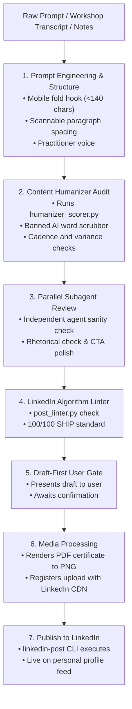

# 🚀 LinkedIn AI Orchestrator

An end-to-end autonomous LinkedIn orchestration system for Antigravity and AI agents. It converts raw transcripts, ideas, or prompts into humanized, algorithm-optimized LinkedIn posts, audits them against AI slop using parallel subagents, attaches high-resolution documents/certificates, and publishes directly to personal LinkedIn profiles via official APIs.

Inspired by and built during the **Outskill AI Orchestrator Workshop** with Vaibhav Sisinty.

---

## 📌 Features

- **Automatic Prompt Engineering**: Upgrades raw or informal prompts into high-converting posts with mobile fold optimization (<140 chars before *"…see more"*).
- **AI-Slop & Humanizer Filter**: Enforces human voice standards using `humanizer_scorer.py` (strips robotic AI trigger words like *delve, tapestry, crucial, leverage*).
- **Parallel Subagent Auditing**: Spawns an independent parallel verification agent to score tone, authenticity, and formatting before publishing.
- **Certificate & Media Attachments**: Converts PDF certificates into crisp 1989×1294px image assets and registers them via LinkedIn's digital media CDN (`feedshare-image`).
- **Official LinkedIn OAuth & REST API v2**: Securely targets personal member timelines (`urn:li:person:...`), avoiding company page misrouting.
- **Draft-First Safety Policy**: Built-in guardrail prevents accidental publishing—always provides a draft and awaits explicit confirmation.

---

## 🏗️ Architecture & Workflow



---

## 📂 Repository Structure

```text
linkedin-ai-orchestrator/
├── skills/
│   └── linkedin-orchestrator/
│       └── SKILL.md            # The Antigravity Skill specification
├── scripts/
│   ├── post_linkedin.py        # CLI tool to publish text & media to LinkedIn
│   ├── linkedin_oauth.py       # Local OAuth 2.0 listener & token exchanger
│   ├── find-skill.py           # Fast semantic skill matcher & router (425+ skills)
│   ├── humanizer_scorer.py     # AI slop detector & human-ness scorer (0-100)
│   └── post_linter.py          # LinkedIn post format & reach linter (0-100)
├── install.sh                  # 1-Click setup & restore script
├── .gitignore                  # Keeps credentials & tokens safe
└── README.md                   # Complete experiment documentation
```

---

## ⚡ 1-Click Restore (If Antigravity is deleted or reinstalled)

If you ever reinstall Antigravity, switch machines, or delete local configs, restore everything in one command:

```bash
git clone https://github.com/<your-username>/linkedin-ai-orchestrator.git
cd linkedin-ai-orchestrator
./install.sh
```

This automatically:
1. Re-installs `linkedin-post` and `find-skill` into your system `$PATH` (`~/.gemini/antigravity/bin/` and `~/.local/bin/`).
2. Registers the `linkedin-orchestrator` skill in `~/.gemini/config/skills/`.
3. Verifies your existing credentials at `~/.gemini/config/linkedin_auth.json`.

---

## 🔑 LinkedIn Connection Setup

### 1. Developer App Credentials
In the [LinkedIn Developer Portal](https://www.linkedin.com/developers/apps):
1. Create an app (e.g. `Antigravity Poster`).
2. Request access to **Share on LinkedIn** and **Sign In with LinkedIn using OpenID Connect** under the **Products** tab.
3. In the **Auth** tab, under **OAuth 2.0 settings**, add:
   ```text
   http://localhost:8080/callback
   ```

### 2. Connect via Antigravity
Run in your terminal:
```bash
linkedin-post --setup
```
Or start the local OAuth listener:
```bash
python3 scripts/linkedin_oauth.py --client-id "<YOUR_CLIENT_ID>" --client-secret "<YOUR_CLIENT_SECRET>"
```
Click the generated link, click **Allow**, and your personal profile token and member URN (`urn:li:person:...`) are automatically captured and saved locally to `~/.gemini/config/linkedin_auth.json`.

---

## 💻 CLI Commands

### Preview & Dry Run
```bash
linkedin-post --dry-run "Testing my LinkedIn integration!"
```

### Publish Post with Certificate
```bash
linkedin-post --file draft.txt --media certificate.png
```

### Audit for AI Slop
```bash
python3 scripts/humanizer_scorer.py draft.txt
```

### Lint for Algorithm Reach
```bash
python3 scripts/post_linter.py --input draft.txt --output human
```

---

## 📝 How to Push This Repository to Your GitHub

To save this project to your GitHub account:

1. Create a new repository on [GitHub](https://github.com/new) named `linkedin-ai-orchestrator`.
2. Run these commands from this directory:

```bash
cd /Users/kanchannath/.gemini/antigravity/scratch/linkedin-ai-orchestrator
git init
git add .
git commit -m "feat: complete LinkedIn AI Orchestrator skill and automation"
git branch -M main
git remote add origin https://github.com/<your-github-username>/linkedin-ai-orchestrator.git
git push -u origin main
```

---

## 📜 License
MIT License. Built for personal automation and agentic workflows.
