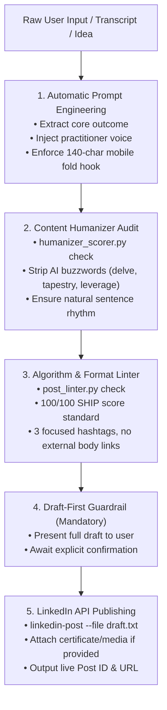

# LinkedIn AI Orchestrator Skill

Autonomous workflow for researching, drafting, humanizing, and publishing high-engagement LinkedIn posts directly to a personal profile.

---

## Operating Workflow



---

## Guardrails & Non-Negotiable Rules

1. **Draft-First Policy**:
   - **Never auto-publish without user approval.**
   - Always present the draft, the humanizer score, and the linter score to the user first.
   - Wait for explicit user confirmation ("Yes, post it") before calling the publishing tool.

2. **Personal Profile Targeting**:
   - Always verify the author URN targets `urn:li:person:<id>` to ensure posts go to the member's personal feed, never a corporate or showcase page.

3. **Human Voice Standards**:
   - Banned words: *delve, tapestry, crucial, multifaceted, leverage, testament, beacon, realm, vital*.
   - No robotic hedging (*"In today's fast-paced world...", "It is important to remember..."*).
   - Varied sentence lengths with concrete details and metrics.

4. **Media Handling**:
   - Single-page PDFs (like certificates) are rendered as crisp PNG assets (1989x1294px) and registered through LinkedIn's `feedshare-image` recipe for rich, full-card display on feeds.

---

## Tool Reference

### 1. Publishing & Media
```bash
# Preview post without sending
linkedin-post --dry-run "Post text..."

# Publish text post (after user approval)
linkedin-post "Post text..."

# Publish post with certificate / image attached
linkedin-post --file draft.txt --media /path/to/certificate.png
```

### 2. Quality & Humanizer Audits
```bash
# Score draft for AI patterns (0-100)
python3 scripts/humanizer_scorer.py draft.txt

# Lint draft for LinkedIn algorithm reach (0-100)
python3 scripts/post_linter.py --input draft.txt --output human
```

### 3. Account Connection
```bash
# Run one-time OAuth setup
linkedin-post --setup
# Or run the local OAuth listener
python3 scripts/linkedin_oauth.py
```
